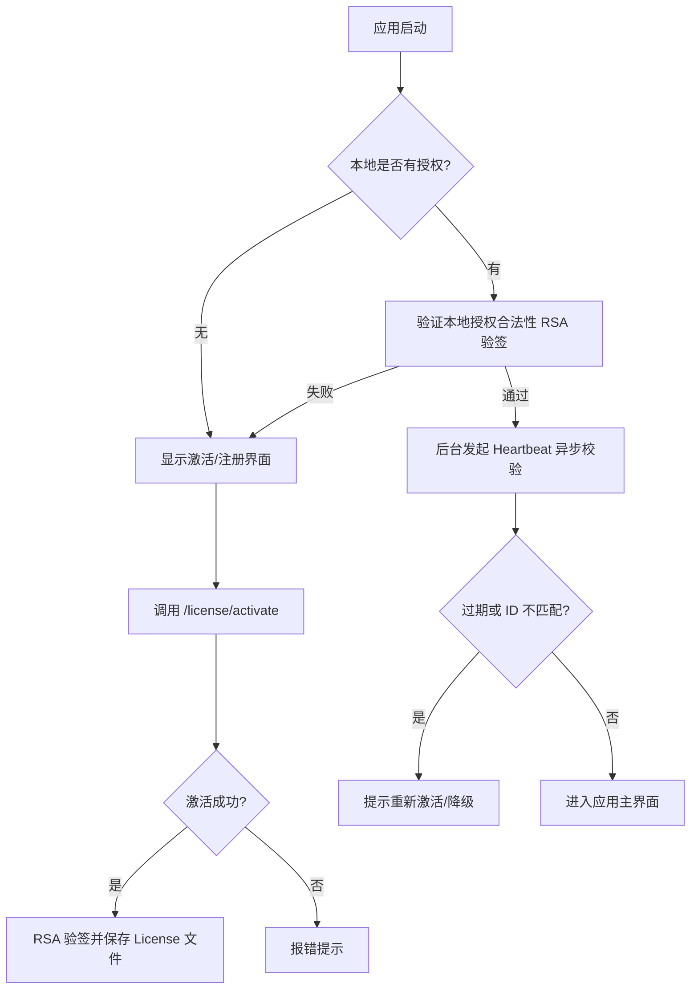

# 客户端授权集成 API 规范

## 基础信息

- **API Base URL**: `http://your-server:8055`
- **认证方式**: 无需认证（公开端点）
- **响应格式**: JSON

## 客户端集成流程



## 👤 用户注册与认证

### 1. 发送注册验证码
**Endpoint**: `POST /auth/register/send-code`

**Request**:
```json
{
  "email": "user@example.com"
}
```

**Response**:
```json
{
  "success": true,
  "message": "验证码已发送"
}
```

> **注意**: 系统已接入阿里云邮件推送 (DirectMail)。验证码将通过 `noreply@fogomo.com` 实时发送至用户邮箱。

### 2. 验证并注册
**Endpoint**: `POST /auth/register/verify`

注册成功后，请直接使用账号密码调用 `/auth/login` 进行登录。

**Request**:
```json
{
  "email": "user@example.com",
  "code": "123456",
  "password": "yourpassword"
}
```

**Response**:
```json
{
  "success": true,
  "data": {
    "user_id": "uuid-..."
  }
}
```

---

## 🔐 安全与防篡改验证

为了防止本地伪造服务器响应，所有成功的 API 响应（HTTP 200）都会包含一个 `signature` 字段。
客户端**必须**使用内置的RSA公钥验证该签名。

**响应结构**:
```json
{
  "success": true,
  "data": { ... 业务数据 ... },
  "signature": "Base64 encoded RSA signature"
}
```

**验签流程**:
1. 客户端收到响应。
2. 提取 `data` 字段的对象。
3. 将 `data` 对象序列化为 JSON 字符串：`const payload = JSON.stringify(response.data)`。
4. 使用内置公钥验证 `signature` 是否匹配 `payload` (算法: SHA256)。
5. 只有验签通过，才允许写入本地 License 文件。

---

## 🛡️ 客户端安全性 (CSP)

为了防止跨站脚本注入 (XSS) 和恶意代码执行，渲染进程**必须**配置合理的 Content Security Policy (CSP)。

**推荐配置**:
```html
<meta http-equiv="Content-Security-Policy" content="default-src 'self' http://localhost:8055; script-src 'self' 'unsafe-inline' 'unsafe-eval'; style-src 'self' 'unsafe-inline'; img-src 'self' data: http://localhost:8055; connect-src 'self' http://localhost:8055 ws://localhost:6173;" />
```

---

## 🛡️ 防破解与安全架构

为了确保商业利益并提升逆向成本，系统采用了以下多重防御机制：

### 1. 通信防伪：RSA-SHA256 签名
- **描述**: 服务端对所有 `data` 响应使用私钥签名，客户端通过内置公钥强验证。
- **目的**: 防止通过篡改 Hosts 或中间人攻击 (MITM) 伪造“激活成功”的服务器响应。

### 2. 硬件绑定：动态设备指纹
- **描述**: 基于 `machine-id` 和硬件特征生成唯一的 `device_id`。
- **目的**: 限制“一码多用”。授权码在服务端会记录关联 of ID，超出套餐上限将无法再次激活。

### 3. 数据隔离：敏感字段本地加密
- **描述**: 客户端本地 SQLite 中的所有 SSH 密钥、证书私钥、密码均经过对称加密存储。
- **目的**: 防止用户直接修改本地数据库字段来实现“白嫖”专业功能。

### 4. 逻辑防线：原子化权限二次校验
- **描述**: 核心自动化任务（如自动续期任务）在执行前会同步校验授权状态。
- **目的**: 绕过 UI 层面的屏蔽无法绕过底层执行逻辑的鉴权。

---

## API 详细说明

### 1. 初始化授权 (领取免费套餐)
**Endpoint**: `POST /license/init`

用户在客户端首次登录时调用。系统会自动检查该应用是否有默认的免费套餐，若有且用户未领取，则自动创建并绑定。

**Request Body**:
```json
{
  "app_code": "certd-electron"
}
```

**Response**:
```json
{
  "success": true,
  "data": {
    "initialized": true,
    "message": "免费套餐领取成功",
    "license": {
      "id": 123,
      "license_key": "xxxx-xxxx-xxxx-xxxx",
      "status": "active",
      "plan": 1
    }
  },
  "signature": "base64-encoded-rsa-signature"
}
```

### 2. 验证授权码
**Endpoint**: `POST /license/verify`

**请求**：
```http
POST /license/verify
Content-Type: application/json

{
  "license_key": "XXXX-XXXX-XXXX-XXXX",
  "app_key": "certd_electron",
  "device_id": "abc123def456"
}
```

**响应**：
```json
{
  "success": true,
  "data": {
    "license_id": "uuid",
    "plan": "pro",
    "status": "active",
    "expire_at": "2027-01-23T00:00:00.000Z",
    "remaining_days": 365,
    "max_devices": 2,
    "current_devices": 1,
    "features": ["auto_renew", "ssh_key_picker"]
  },
  "signature": "base64-encoded-rsa-signature"
}
```

### 3. 激活授权
**Endpoint**: `POST /license/activate`

**请求**：
```json
{
  "license_key": "XXXX-XXXX-XXXX-XXXX",
  "app_key": "certd_electron",
  "device_id": "abc123def456",
  "device_name": "MacBook Pro",
  "platform": "darwin"
}
```

**响应**：
```json
{
  "success": true,
  "data": {
    "license_id": "uuid",
    "plan": "pro",
    "expire_at": "2027-01-23T00:00:00.000Z",
    "message": "激活成功"
  },
  "signature": "base64-encoded-rsa-signature"
}
```

### 4. 同步证书配置 (云端备份)
**Endpoint**: `POST /license/sync-cert`

**请求**：
```json
{
  "license_id": "uuid",
  "domain": "example.com",
  "email": "admin@example.com",
  "provider": "aliyun"
}
```

**响应**：
```json
{
  "success": true,
  "data": {
    "message": "同步成功"
  },
  "signature": "base64-encoded-rsa-signature"
}
```

### 5. 心跳检测与续期检查
**Endpoint**: `POST /license/heartbeat`

**响应**：
```json
{
  "success": true,
  "data": {
    "valid": true,
    "expire_at": "2027-01-23T00:00:00.000Z"
  },
  "signature": "base64-encoded-rsa-signature"
}
```

### 6. 解绑设备
**Endpoint**: `POST /license/deactivate`

**响应**：
```json
{
  "success": true,
  "data": {
    "message": "设备已解绑"
  },
  "signature": "base64-encoded-rsa-signature"
}
```

## 错误码说明

| 错误码 | 说明 | 处理建议 |
|-------|------|---------|
| `MISSING_PARAMS` | 缺少必要参数 | 检查请求参数 |
| `INVALID_APP` | 无效的应用标识 | 检查 app_key 是否正确 |
| `INVALID_LICENSE` | 无效的授权码 | 提示用户重新输入 |
| `LICENSE_BLOCKED` | 授权码已被禁用 | 提示用户联系客服 |
| `LICENSE_EXPIRED` | 授权码已过期 | 引导用户续费 |
| `DEVICE_LIMIT_EXCEEDED` | 设备数量超限 | 引导用户解绑其他设备 |
| `DEVICE_NOT_FOUND` | 设备未绑定 | 提示用户重新激活 |
| `SERVER_ERROR` | 服务器错误 | 提示用户稍后重试 |

## 客户端实现建议

### 设备指纹生成

```javascript
const crypto = require('crypto')
const os = require('os')
const { machineIdSync } = require('node-machine-id')

function generateDeviceId() {
  const data = [
    machineIdSync(),
    os.hostname(),
    os.platform(),
    os.arch()
  ].join('|')
  
  return crypto.createHash('sha256').update(data).digest('hex')
}
```

### 本地缓存结构

```javascript
{
  license: {
    license_id: "uuid",
    license_key: "XXXX-XXXX-XXXX-XXXX",
    plan: "professional",
    expiry_date: "2027-01-23T00:00:00.000Z",
    features: ["auto_renew"],
    limits: {
      max_domains: -1,
      max_servers: 5
    },
    last_verified: 1234567890000,
    offline_since: null
  }
}
```

### 离线处理

- 允许离线使用 7 天
- 超过宽限期后降级为免费版功能
- 恢复网络后自动重新验证

---

---

## 💰 订单与支付 API

### 1. 发起下单
**Endpoint**: `POST /orders/create`

**请求**:
```json
{
  "plan_id": "套餐UUID",
  "email": "买家邮箱"
}
```

**响应**:
```json
{
  "success": true,
  "data": {
    "order_id": "uuid",
    "order_no": "ORD...",
    "amount": 99.00,
    "qr_code": "/assets/file_id",
    "message": "订单已创建，请扫码支付"
  },
  "signature": "base64-encoded-rsa-signature"
}
```

### 2. 检查支付状态
**Endpoint**: `GET /orders/check/:order_id`

**响应**:
```json
{
  "success": true,
  "data": {
    "status": "paid",
    "is_paid": true
  },
  "signature": "base64-encoded-rsa-signature"
}
```

### 3. 后端自动化逻辑 (订单钩子)
后端会自动监听订单状态。当状态变更为 `paid` 时：
- **自动延期**: 如果用户已有授权，将在现有有效期基础上顺延（例如增加 12 个月）。
- **自动创建**: 如果是新邮箱用户，将自动创建一个新的 `pro` 计划授权。
- **即时生效**: 客户端在下次验证授权或收到支付成功通知后刷新，即可获得专业版权限。
